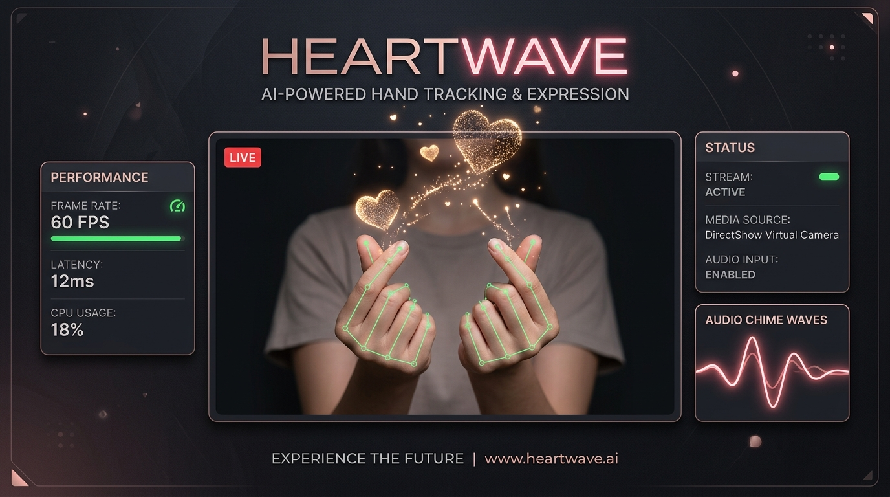
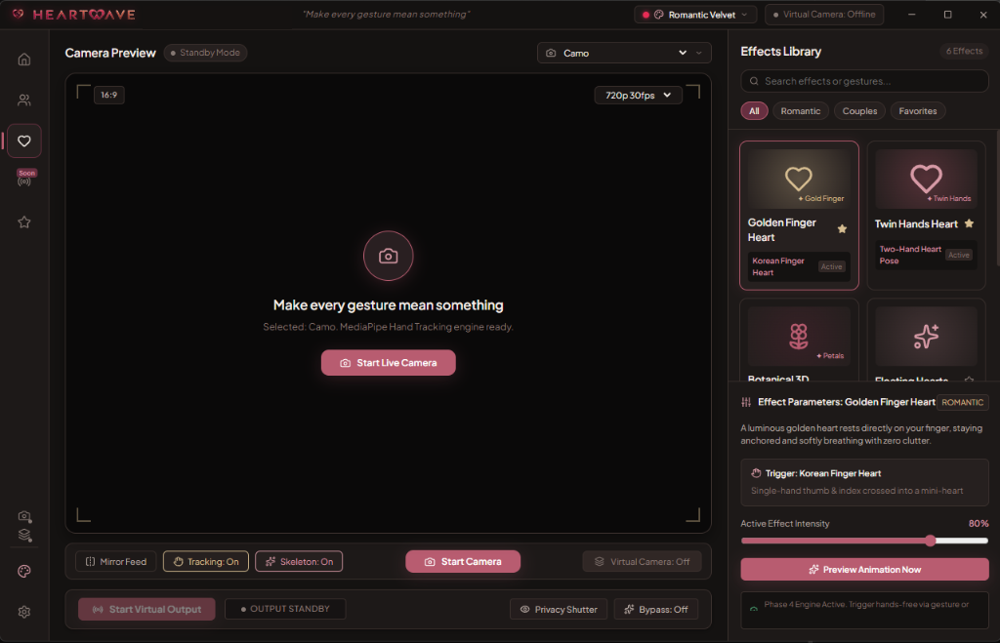
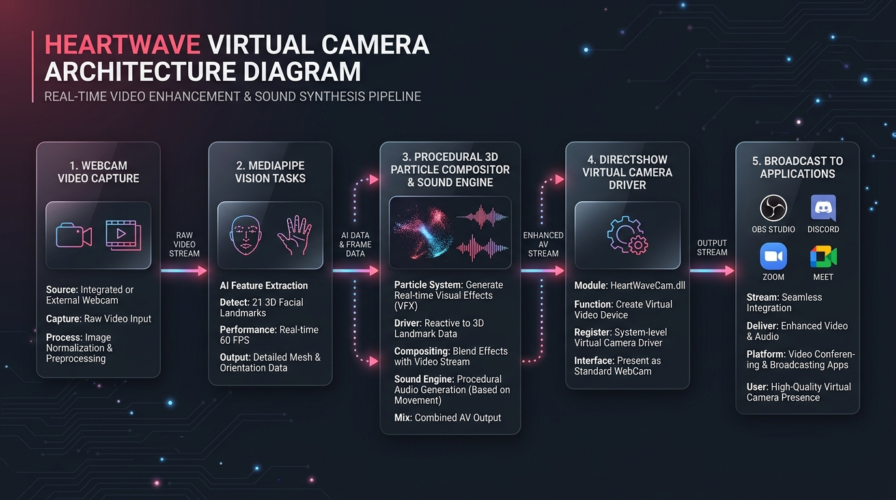

# 💖 HeartWave

<p align="center">
  <strong>Real-Time Gesture-Powered Virtual Camera with 3D Cinematic Visual Effects</strong>
</p>

<p align="center">
  <a href="https://github.com/Jithin0306/HeartWave/releases/latest">
    
  </a>
  
  
  
</p>

<p align="center">
  
</p>

---

## 🌟 Overview

<p align="center">
  
</p>

**HeartWave** transforms your ordinary webcam into an interactive, gesture-responsive virtual broadcast camera. Powered by Google MediaPipe AI running 100% locally on your machine, HeartWave detects your hand gestures in real time and renders procedural 3D visual effects directly onto your video feed.

The output streams seamlessly as **"Heartwave Virtual Camera"** into any Windows video software, including:
- **Discord Desktop**
- **OBS Studio**
- **Zoom**
- **Google Meet / Chrome**
- **Microsoft Teams**
- **WhatsApp Desktop**

---

## 🚀 Key Features

- **🤲 Sub-Millisecond Gesture Tracking**:
  - Real-time 21-point 3D hand landmark estimation powered by MediaPipe Vision WASM.
  - Dual-hand detection, predictive landmark smoothing, and adaptive gesture state machine.
- **✨ Procedural 3D Visual Effects**:
  - **Floating Hearts**: Interactive particles with physics and glow.
  - **3D Rose Bloom**: Organic petal blossoming triggered by pinch/heart gestures.
  - **Cupid Spark**: High-velocity romantic sparkles and trail rays.
  - **Twin Hands Heart**: Duo-palm tracking with synchronized aura.
  - **Petal Rain**: Ambient falling blossom petals with wind turbulence simulation.
- **🎥 Standalone Native DirectShow Virtual Camera**:
  - Custom C++ DirectShow filter (`HeartWaveCam.dll`) paired with a high-throughput shared memory bridge (`HeartWaveBridge.exe`).
  - Zero dependencies on OBS Studio — works fully standalone.
- **🔔 Background Streaming & System Tray**:
  - Closing or minimizing the app parks HeartWave in the Windows System Tray without dropping frames in OBS or Discord.
- **⌨️ System-Wide Global Hotkeys**:
  - Control privacy, bypass mode, and virtual camera state even while gaming in full-screen.
- **🎵 Procedural Audio Feedback**:
  - Zero-dependency Web Audio API synthesizer generates real-time harmonious acoustic chimes upon gesture triggers.
- **🎨 4 Tailored Workspace Themes**:
  - *Romantic Blush*, *Studio Neutral*, *Cyber Neon*, and *Midnight Slate* with authentic 3D typography.
- **🛡️ 100% Private & On-Device**:
  - Zero video frames or biometric data leave your computer. No cloud telemetry, no accounts required.
- **🔄 Built-In Auto-Updates**:
  - Instant over-the-air differential updates delivered through GitHub Releases via `electron-updater`.

---

## 📥 Quick Download & Installation

1. Head over to the [**Latest Releases Page**](https://github.com/Jithin0306/HeartWave/releases/latest).
2. Download **`HeartWave-Setup-1.0.0.exe`**.
3. Double-click the installer and launch HeartWave.
4. Select your webcam, turn on **"Start Virtual Camera"** (or press `Ctrl+Shift+V`), and pick **Heartwave Virtual Camera** in your favorite streaming or meeting app!

---

## ⌨️ Global Shortcuts

| Shortcut | Action | Description |
| :--- | :--- | :--- |
| <kbd>Ctrl</kbd> + <kbd>Shift</kbd> + <kbd>P</kbd> | **Privacy Shutter** | Immediately blacks out the video feed |
| <kbd>Ctrl</kbd> + <kbd>Shift</kbd> + <kbd>B</kbd> | **Bypass Mode** | Sends clean, raw camera feed with zero effects |
| <kbd>Ctrl</kbd> + <kbd>Shift</kbd> + <kbd>V</kbd> | **Toggle Virtual Camera** | Starts or stops the DirectShow video broadcast |
| <kbd>Ctrl</kbd> + <kbd>Shift</kbd> + <kbd>M</kbd> | **Toggle Mirror** | Horizontally flips the camera view |

---

## 🛠️ Tech Stack & Architecture

<p align="center">
  
</p>

```
[ Physical Webcam ]
         │
         ▼
[ MediaPipe Vision WASM (Local 21-3D Landmarks) ]
         │
         ▼
[ Gesture State Machine & Predictive Smoother ]
         │
         ▼
[ Canvas 2D / WebGL Procedural Compositor ] ──► [ Web Audio Synthesizer ]
         │
         ▼
[ Named Shared Memory Ring Buffer ]
         │
         ▼
[ C++ DirectShow Virtual Camera Filter (HeartWaveCam.dll) ]
         │
         ▼
[ Discord / OBS / Zoom / Chrome ]
```

- **Frontend**: React 18, TypeScript, Tailwind/CSS Tokens, Lucide Icons, Zustand
- **Desktop Runtime**: Electron 34, Node.js, esbuild, Vite
- **Vision AI**: Google MediaPipe Tasks Vision (`@mediapipe/tasks-vision`)
- **Native Video Pipeline**: C++ DirectShow BaseClasses Filter (`HeartWaveCam.dll`), C# Native IPC Bridge (`HeartWaveBridge.exe`)
- **Packaging & Delivery**: `electron-builder`, `electron-updater`, NSIS

---

## 💻 Developer Setup & Building from Source

### Prerequisites
- [Node.js 18+](https://nodejs.org/)
- Windows 10 or 11 (64-bit)

### Installation
```bash
# Clone the repository
git clone https://github.com/Jithin0306/HeartWave.git
cd HeartWave

# Install dependencies
npm install
```

### Running in Development
```bash
npm run dev
```

### Production Build & Packaging
```bash
# Typecheck and build frontend + main process
npm run build

# Package unpacked directory
npm run pack

# Build standalone Windows NSIS installer
npm run dist

# Build and publish new release to GitHub
npm run release
```

---

## 📄 License

This project is licensed under the [MIT License](LICENSE).
